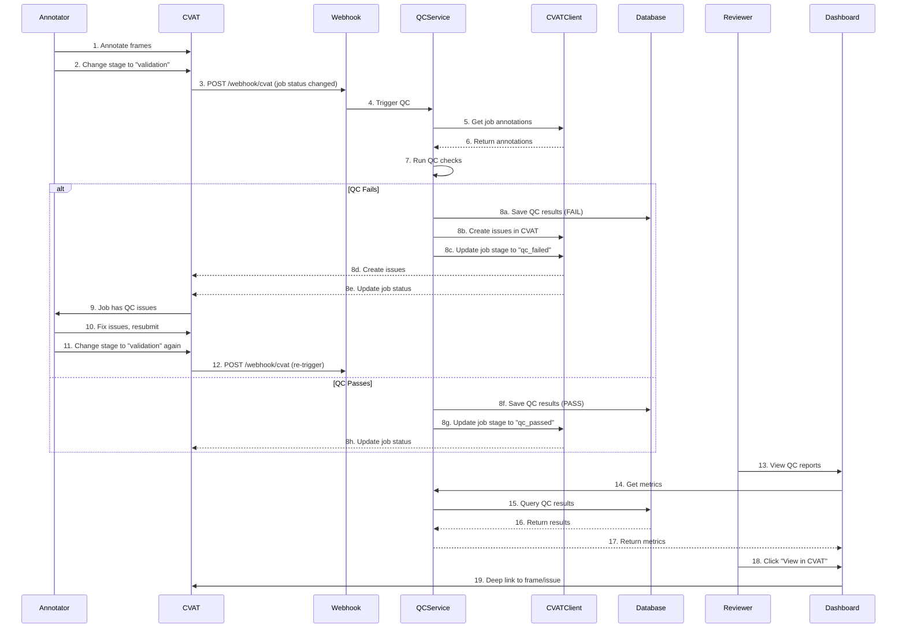

# Phase 2: CVAT Integration & Workflow Automation

## 📌 Overview

**Duration:** 4 weeks  
**Start Date:** 2026-11-05  
**End Date:** 2026-12-03  
**Status:** ⏳ Planned  
**Priority:** 🔴 HIGH

---

## 🎯 Objectives

Implement **dual-system integration** with CVAT:

1. **Enhanced CVAT Webhook Handler** - Handle all CVAT job events
2. **Enhanced CVAT API Client** - Full CVAT API coverage
3. **Workflow Automation** - Auto-trigger QC, create issues, update status
4. **Deep Linking** - Generate CVAT UI URLs from dashboard

---

## 🏗️ Integration Architecture

```
┌─────────────────┐       ┌─────────────────┐       ┌─────────────────┐
│     CVAT        │       │   LetmeQC       │       │   Dashboard UI  │
│  (Annotation)   │       │   (Backend)     │       │  (Frontend)     │
└────────┬────────┘       └────────┬────────┘       └────────┬────────┘
         │                         │                         │
         │ 1. Job Status Change    │                         │
         │ (Webhook)               │                         │
         ▼                         ▼                         ▼
┌─────────────────┐       ┌─────────────────┐       ┌─────────────────┐
│  CVAT Webhook    │───▶  │  Webhook Handler │       │  API Client      │
│  (POST event)    │       │  (validate,     │       │  (Fetch reports) │
└─────────────────┘       │   route)        │       └─────────────────┘
                              │
                              ▼
                    ┌─────────────────┐
                    │   QC Service    │
                    │  (fetch, run QC) │
                    └────────┬────────┘
                              │
         ┌────────────────────┼────────────────────┐
         ▼                    ▼                    ▼
┌─────────────┐    ┌─────────────┐        ┌─────────────┐
│ CVAT API     │    │ Database    │        │ Report      │
│ create_issue │    │ (Save QC    │        │ Service     │
│ update_status│    │  results)    │        │ (Generate   │
└─────────────┘    └─────────────┘        │  metrics)    │
                                              └─────────────┘
```

---

## 🔄 Workflow Diagram



---

## 📋 Detailed Tasks

### 2.1 Enhanced CVAT Webhook Handler

**Duration:** Week 1  
**Owner:** Integration Specialist  
**Estimate:** 5 days

#### Tasks

| ID | Task | Description | Estimate | Status |
|----|------|-------------|----------|--------|
| WH-01 | Analyze CVAT webhook events | Document all webhook event types and payloads | 1 day | ⏳ |
| WH-02 | Enhance webhook validation | Validate signature, IP, and payload structure | 2 days | ⏳ |
| WH-03 | Implement event routing | Route different events to appropriate handlers | 2 days | ⏳ |

#### Webhook Event Types

| Event Type | Trigger | Action | Priority |
|------------|---------|--------|----------|
| `job.status.changed` | Job status changes | Trigger QC if stage is "validation" | HIGH |
| `job.created` | New job created | Create job record in database | MEDIUM |
| `job.updated` | Job metadata updated | Update job record | MEDIUM |
| `job.deleted` | Job deleted | Mark job as deleted in database | MEDIUM |
| `task.created` | New task created | Create job record | MEDIUM |
| `task.updated` | Task updated | Update job record | MEDIUM |
| `ping` | Health check | Respond with pong | LOW |
| `*` | Unknown events | Log and ignore | LOW |

#### Webhook Implementation

```python
# src/handlers/webhook_handlers.py (Enhanced)
import hmac
import hashlib
import json
import logging
from typing import Dict, Any, Optional
from fastapi import Request, HTTPException, status, Depends
from fastapi.responses import JSONResponse

from src.config.settings import get_settings
from src.services.qc_service import QCService
from src.services.job_service import JobService
from src.clients.cvat_client import CVATClient
from src.models.job import JobStage

logger = logging.getLogger(__name__)
settings = get_settings()


class WebhookHandler:
    """Enhanced webhook handler for CVAT events."""
    
    def __init__(self):
        self.cvat_client = CVATClient()
    
    def validate_webhook(self, request: Request, payload: Dict[str, Any]) -> bool:
        """
        Validate webhook request.
        
        Args:
            request: FastAPI Request object
            payload: Parsed JSON payload
            
        Returns:
            True if valid, raises HTTPException if invalid
        """
        # Check for secret
        if not settings.WEBHOOK_SECRET:
            logger.warning("No WEBHOOK_SECRET configured, skipping validation")
            return True
        
        # Get signature from headers
        signature = request.headers.get("X-CVAT-Signature")
        if not signature:
            raise HTTPException(
                status_code=status.HTTP_400_BAD_REQUEST,
                detail="Missing X-CVAT-Signature header"
            )
        
        # Verify signature
        expected_signature = hmac.new(
            settings.WEBHOOK_SECRET.encode(),
            json.dumps(payload, sort_keys=True).encode(),
            hashlib.sha256
        ).hexdigest()
        
        if not hmac.compare_digest(signature, expected_signature):
            raise HTTPException(
                status_code=status.HTTP_401_UNAUTHORIZED,
                detail="Invalid webhook signature"
            )
        
        return True
    
    def handle_webhook(self, request: Request, payload: Dict[str, Any]) -> JSONResponse:
        """
        Main webhook handler that routes events.
        
        Args:
            request: FastAPI Request object
            payload: Parsed JSON payload
            
        Returns:
            JSONResponse with status
        """
        try:
            # Validate webhook
            self.validate_webhook(request, payload)
            
            # Extract event type
            event = payload.get("event", "")
            action = payload.get("action", "")
            
            # Log event
            logger.info(f"Webhook received: event={event}, action={action}")
            
            # Route to appropriate handler
            if event == "ping":
                return self.handle_ping(payload)
            elif event == "job.status.changed":
                return self.handle_job_status_changed(payload)
            elif event == "job.created":
                return self.handle_job_created(payload)
            elif event == "job.updated":
                return self.handle_job_updated(payload)
            elif event == "job.deleted":
                return self.handle_job_deleted(payload)
            else:
                return self.handle_unknown(payload)
                
        except Exception as e:
            logger.error(f"Webhook handling failed: {e}", exc_info=True)
            return JSONResponse(
                status_code=status.HTTP_500_INTERNAL_SERVER_ERROR,
                content={"status": "error", "message": str(e)}
            )
    
    def handle_ping(self, payload: Dict[str, Any]) -> JSONResponse:
        """Handle CVAT ping event."""
        logger.debug("Handling ping event")
        return JSONResponse(
            status_code=status.HTTP_200_OK,
            content={"status": "pong"}
        )
    
    def handle_job_status_changed(self, payload: Dict[str, Any]) -> JSONResponse:
        """
        Handle job status changed event.
        
        This is the main event that triggers QC processing.
        """
        logger.info("Handling job.status.changed event")
        
        # Extract job information
        job_id = payload.get("job", {}).get("id")
        job_stage = payload.get("job", {}).get("stage")
        job_status = payload.get("job", {}).get("status")
        
        if not job_id:
            return JSONResponse(
                status_code=status.HTTP_400_BAD_REQUEST,
                content={"status": "error", "message": "Missing job ID"}
            )
        
        logger.info(f"Job {job_id} status changed: stage={job_stage}, status={job_status}")
        
        # Only trigger QC when job moves to validation stage
        if job_stage == JobStage.VALIDATION.value:
            logger.info(f"Triggering QC for job {job_id} (moved to validation)")
            qc_service = QCService()
            result = qc_service.run_qc(job_id)
            
            if result.get("status") == "success":
                logger.info(f"QC completed for job {job_id}: {result.get('total_errors', 0)} errors")
                
                # If there are errors, create issues in CVAT
                if result.get("total_errors", 0) > 0:
                    logger.info(f"Creating issues in CVAT for job {job_id}")
                    qc_service.process_failure(job_id)
                else:
                    logger.info(f"QC passed for job {job_id}")
                    qc_service.process_success(job_id)
                
                return JSONResponse(
                    status_code=status.HTTP_200_OK,
                    content={
                        "status": "success",
                        "job_id": job_id,
                        "message": "QC processing triggered",
                        "errors": result.get("total_errors", 0)
                    }
                )
            else:
                logger.error(f"QC failed for job {job_id}: {result.get('error')}")
                return JSONResponse(
                    status_code=status.HTTP_500_INTERNAL_SERVER_ERROR,
                    content={
                        "status": "error",
                        "job_id": job_id,
                        "message": result.get("error", "QC processing failed")
                    }
                )
        
        return JSONResponse(
            status_code=status.HTTP_200_OK,
            content={"status": "skipped", "message": f"Job stage is {job_stage}, not triggering QC"}
        )
    
    def handle_job_created(self, payload: Dict[str, Any]) -> JSONResponse:
        """Handle job created event."""
        logger.info("Handling job.created event")
        
        job_id = payload.get("job", {}).get("id")
        if job_id:
            # Create job record in database
            job_service = JobService()
            job_info = self.cvat_client.get_job_info(job_id)
            
            job_service.create_job({
                "cvat_job_id": job_id,
                "name": job_info.get("name", f"Job {job_id}"),
                "status": "pending",
                "stage": job_info.get("stage", "annotation"),
                "metadata": job_info
            })
        
        return JSONResponse(
            status_code=status.HTTP_200_OK,
            content={"status": "success", "job_id": job_id}
        )
    
    def handle_job_updated(self, payload: Dict[str, Any]) -> JSONResponse:
        """Handle job updated event."""
        logger.info("Handling job.updated event")
        
        job_id = payload.get("job", {}).get("id")
        if job_id:
            # Update job record in database
            job_service = JobService()
            job_info = self.cvat_client.get_job_info(job_id)
            
            job = job_service.get_job_by_cvat_id(job_id)
            if job:
                job_service.update_job(job.id, {
                    "status": job_info.get("status", job.status),
                    "stage": job_info.get("stage", job.stage),
                    "metadata": job_info
                })
        
        return JSONResponse(
            status_code=status.HTTP_200_OK,
            content={"status": "success", "job_id": job_id}
        )
    
    def handle_job_deleted(self, payload: Dict[str, Any]) -> JSONResponse:
        """Handle job deleted event."""
        logger.info("Handling job.deleted event")
        
        job_id = payload.get("job", {}).get("id")
        if job_id:
            # Mark job as deleted in database
            job_service = JobService()
            job = job_service.get_job_by_cvat_id(job_id)
            if job:
                job_service.update_job(job.id, {
                    "status": "deleted",
                    "stage": "deleted"
                })
        
        return JSONResponse(
            status_code=status.HTTP_200_OK,
            content={"status": "success", "job_id": job_id}
        )
    
    def handle_unknown(self, payload: Dict[str, Any]) -> JSONResponse:
        """Handle unknown events."""
        logger.warning(f"Unknown webhook event: {payload.get('event')}")
        return JSONResponse(
            status_code=status.HTTP_200_OK,
            content={"status": "ignored", "message": "Unknown event type"}
        )


# FastAPI router
webhook_router = APIRouter(prefix="/webhook", tags=["webhook"])
webhook_handler = WebhookHandler()


@webhook_router.post("/cvat")
async def handle_cvat_webhook(request: Request):
    """
    CVAT webhook endpoint.
    
    Receives webhook events from CVAT and processes them accordingly.
    """
    try:
        payload = await request.json()
        return webhook_handler.handle_webhook(request, payload)
    except json.JSONDecodeError:
        return JSONResponse(
            status_code=status.HTTP_400_BAD_REQUEST,
            content={"status": "error", "message": "Invalid JSON payload"}
        )
```

---

### 2.2 Enhanced CVAT API Client

**Duration:** Week 1-2  
**Owner:** Integration Specialist  
**Estimate:** 5 days

#### Tasks

| ID | Task | Description | Estimate | Status |
|----|------|-------------|----------|--------|
| CVAT-01 | Research CVAT API | Document all required endpoints | 1 day | ⏳ |
| CVAT-02 | Implement pagination | Handle paginated responses | 2 days | ⏳ |
| CVAT-03 | Enhance error handling | Better error messages and retries | 1 day | ⏳ |
| CVAT-04 | Add missing endpoints | Issues, users, projects | 2 days | ⏳ |

#### CVAT API Client Implementation

```python
# src/clients/cvat_client.py (Enhanced)
import httpx
import logging
from typing import Optional, Dict, Any, List, Generator
from urllib.parse import urljoin

from src.config.settings import get_settings
from src.utils.retry import retry_with_backoff

logger = logging.getLogger(__name__)
settings = get_settings()


class CVATClient:
    """Enhanced CVAT API client with comprehensive endpoint coverage."""
    
    def __init__(self, token: Optional[str] = None, api_url: Optional[str] = None):
        self.token = token or settings.CVAT_TOKEN
        self.api_url = api_url or settings.CVAT_API_URL
        self.org_slug = settings.CVAT_ORG_SLUG
        self.timeout = 30.0
        
        # Initialize HTTP client
        self.client = httpx.AsyncClient(
            base_url=self.api_url,
            timeout=self.timeout,
            headers={
                "Authorization": f"Token {self.token}",
                "Content-Type": "application/json"
            }
        )
        
        if self.org_slug:
            self.client.headers["X-Organization"] = self.org_slug
    
    async def __aenter__(self):
        return self
    
    async def __aexit__(self, exc_type, exc_val, exc_tb):
        await self.client.aclose()
    
    async def _request(self, method: str, endpoint: str, **kwargs) -> Dict[str, Any]:
        """
        Make API request with error handling.
        
        Args:
            method: HTTP method (GET, POST, PUT, DELETE)
            endpoint: API endpoint path
            **kwargs: Additional arguments for httpx
            
        Returns:
            Parsed JSON response
            
        Raises:
            CVATError: If request fails
        """
        url = urljoin(self.api_url, endpoint)
        
        try:
            response = await self.client.request(method, url, **kwargs)
            response.raise_for_status()
            return response.json()
        except httpx.HTTPStatusError as e:
            logger.error(f"CVAT API error: {method} {url} - {e.response.status_code}: {e.response.text}")
            raise CVATError(
                f"CVAT API error: {e.response.status_code} - {e.response.text}"
            )
        except httpx.RequestError as e:
            logger.error(f"CVAT API request error: {method} {url} - {e}")
            raise CVATError(f"CVAT API request error: {e}")
        except Exception as e:
            logger.error(f"Unexpected error calling CVAT API: {e}")
            raise CVATError(f"Unexpected error: {e}")
    
    # ==================== JOB ENDPOINTS ====================
    
    @retry_with_backoff(max_retries=3)
    async def get_job_info(self, job_id: int) -> Dict[str, Any]:
        """
        Get job information.
        
        Args:
            job_id: CVAT job ID
            
        Returns:
            Job information dictionary
        """
        return await self._request("GET", f"/jobs/{job_id}")
    
    @retry_with_backoff(max_retries=3)
    async def list_jobs(self, project_id: Optional[int] = None, 
                       status: Optional[str] = None, stage: Optional[str] = None,
                       limit: int = 100, offset: int = 0) -> List[Dict[str, Any]]:
        """
        List jobs with optional filters.
        
        Args:
            project_id: Filter by project ID
            status: Filter by job status
            stage: Filter by job stage
            limit: Maximum number of results
            offset: Number of results to skip
            
        Returns:
            List of job dictionaries
        """
        params = {"limit": limit, "offset": offset}
        if project_id:
            params["project_id"] = project_id
        if status:
            params["status"] = status
        if stage:
            params["stage"] = stage
        
        return await self._request("GET", "/jobs", params=params)
    
    @retry_with_backoff(max_retries=3)
    async def update_job(self, job_id: int, status: Optional[str] = None,
                        stage: Optional[str] = None, assignee_id: Optional[int] = None) -> Dict[str, Any]:
        """
        Update job status and/or stage.
        
        Args:
            job_id: CVAT job ID
            status: New job status
            stage: New job stage
            assignee_id: New assignee ID
            
        Returns:
            Updated job information
        """
        data = {}
        if status:
            data["status"] = status
        if stage:
            data["stage"] = stage
        if assignee_id:
            data["assignee_id"] = assignee_id
        
        return await self._request("PATCH", f"/jobs/{job_id}", json=data)
    
    # ==================== ANNOTATION ENDPOINTS ====================
    
    @retry_with_backoff(max_retries=3)
    async def get_job_annotations(self, job_id: int) -> Dict[str, Any]:
        """
        Get all annotations for a job.
        
        Args:
            job_id: CVAT job ID
            
        Returns:
            Annotations data dictionary
        """
        return await self._request("GET", f"/jobs/{job_id}/annotations")
    
    async def get_job_annotations_paginated(self, job_id: int, 
                                          page: int = 1, page_size: int = 100) -> Generator[Dict[str, Any], None, None]:
        """
        Get job annotations with pagination.
        
        Args:
            job_id: CVAT job ID
            page: Page number (1-based)
            page_size: Number of items per page
            
        Yields:
            Annotation data dictionaries
        """
        offset = (page - 1) * page_size
        
        while True:
            params = {"limit": page_size, "offset": offset}
            data = await self._request("GET", f"/jobs/{job_id}/annotations", params=params)
            
            annotations = data.get("results", [])
            if not annotations:
                break
            
            for annotation in annotations:
                yield annotation
            
            # Check if there are more pages
            if len(annotations) < page_size:
                break
            
            offset += page_size
            page += 1
    
    @retry_with_backoff(max_retries=3)
    async def get_job_labels(self, job_id: int) -> List[Dict[str, Any]]:
        """
        Get label mappings for a job.
        
        Args:
            job_id: CVAT job ID
            
        Returns:
            List of label dictionaries
        """
        data = await self._request("GET", f"/jobs/{job_id}/labels")
        return data.get("results", [])
    
    # ==================== ISSUE ENDPOINTS ====================
    
    @retry_with_backoff(max_retries=3)
    async def create_issue(self, job_id: int, frame: int, position: Dict[str, Any],
                         message: str, assignee_id: Optional[int] = None) -> Dict[str, Any]:
        """
        Create a new issue in CVAT.
        
        Args:
            job_id: CVAT job ID
            frame: Frame index
            position: Position dictionary {x, y, width, height}
            message: Issue message
            assignee_id: Optional assignee ID
            
        Returns:
            Created issue information
        """
        data = {
            "job_id": job_id,
            "frame": frame,
            "position": position,
            "message": message
        }
        if assignee_id:
            data["assignee_id"] = assignee_id
        
        return await self._request("POST", "/issues", json=data)
    
    @retry_with_backoff(max_retries=3)
    async def get_issue(self, issue_id: int) -> Dict[str, Any]:
        """
        Get issue details.
        
        Args:
            issue_id: CVAT issue ID
            
        Returns:
            Issue information dictionary
        """
        return await self._request("GET", f"/issues/{issue_id}")
    
    @retry_with_backoff(max_retries=3)
    async def list_issues(self, job_id: Optional[int] = None, 
                         status: Optional[str] = None, assignee_id: Optional[int] = None,
                         limit: int = 100, offset: int = 0) -> List[Dict[str, Any]]:
        """
        List issues with optional filters.
        
        Args:
            job_id: Filter by job ID
            status: Filter by issue status
            assignee_id: Filter by assignee ID
            limit: Maximum number of results
            offset: Number of results to skip
            
        Returns:
            List of issue dictionaries
        """
        params = {"limit": limit, "offset": offset}
        if job_id:
            params["job_id"] = job_id
        if status:
            params["status"] = status
        if assignee_id:
            params["assignee_id"] = assignee_id
        
        data = await self._request("GET", "/issues", params=params)
        return data.get("results", [])
    
    @retry_with_backoff(max_retries=3)
    async def update_issue(self, issue_id: int, status: Optional[str] = None,
                          assignee_id: Optional[int] = None, message: Optional[str] = None) -> Dict[str, Any]:
        """
        Update an issue.
        
        Args:
            issue_id: CVAT issue ID
            status: New issue status
            assignee_id: New assignee ID
            message: Updated message
            
        Returns:
            Updated issue information
        """
        data = {}
        if status:
            data["status"] = status
        if assignee_id:
            data["assignee_id"] = assignee_id
        if message:
            data["message"] = message
        
        return await self._request("PATCH", f"/issues/{issue_id}", json=data)
    
    @retry_with_backoff(max_retries=3)
    async def delete_issue(self, issue_id: int) -> None:
        """
        Delete an issue.
        
        Args:
            issue_id: CVAT issue ID
        """
        await self._request("DELETE", f"/issues/{issue_id}")
    
    # ==================== USER ENDPOINTS ====================
    
    @retry_with_backoff(max_retries=3)
    async def get_user(self, user_id: int) -> Dict[str, Any]:
        """
        Get user information.
        
        Args:
            user_id: CVAT user ID
            
        Returns:
            User information dictionary
        """
        return await self._request("GET", f"/users/{user_id}")
    
    @retry_with_backoff(max_retries=3)
    async def list_users(self, email: Optional[str] = None, 
                        limit: int = 100, offset: int = 0) -> List[Dict[str, Any]]:
        """
        List users with optional filters.
        
        Args:
            email: Filter by email
            limit: Maximum number of results
            offset: Number of results to skip
            
        Returns:
            List of user dictionaries
        """
        params = {"limit": limit, "offset": offset}
        if email:
            params["email"] = email
        
        data = await self._request("GET", "/users", params=params)
        return data.get("results", [])
    
    # ==================== PROJECT ENDPOINTS ====================
    
    @retry_with_backoff(max_retries=3)
    async def get_project(self, project_id: int) -> Dict[str, Any]:
        """
        Get project information.
        
        Args:
            project_id: CVAT project ID
            
        Returns:
            Project information dictionary
        """
        return await self._request("GET", f"/projects/{project_id}")
    
    @retry_with_backoff(max_retries=3)
    async def list_projects(self, limit: int = 100, offset: int = 0) -> List[Dict[str, Any]]:
        """
        List all projects.
        
        Args:
            limit: Maximum number of results
            offset: Number of results to skip
            
        Returns:
            List of project dictionaries
        """
        params = {"limit": limit, "offset": offset}
        data = await self._request("GET", "/projects", params=params)
        return data.get("results", [])
    
    # ==================== FRAME ENDPOINTS ====================
    
    @retry_with_backoff(max_retries=3)
    async def get_frame_data(self, job_id: int, frame: int, quality: str = "original") -> bytes:
        """
        Get frame image data.
        
        Args:
            job_id: CVAT job ID
            frame: Frame index
            quality: Image quality (original, compressed)
            
        Returns:
            Frame image as bytes
        """
        response = await self.client.get(
            f"{self.api_url}/jobs/{job_id}/frames/{frame}/data",
            params={"quality": quality}
        )
        response.raise_for_status()
        return response.content


class CVATError(Exception):
    """Custom exception for CVAT API errors."""
    pass
```

#### Retry Utility

```python
# src/utils/retry.py
import asyncio
import logging
from typing import Callable, TypeVar, Any
from functools import wraps

logger = logging.getLogger(__name__)

T = TypeVar('T')


def retry_with_backoff(max_retries: int = 3, base_delay: float = 1.0,
                       max_delay: float = 10.0, backoff_factor: float = 2.0):
    """
    Decorator for retrying async functions with exponential backoff.
    
    Args:
        max_retries: Maximum number of retries
        base_delay: Initial delay in seconds
        max_delay: Maximum delay in seconds
        backoff_factor: Multiplier for delay between retries
    """
    def decorator(func: Callable[..., T]) -> Callable[..., T]:
        @wraps(func)
        async def wrapper(*args: Any, **kwargs: Any) -> T:
            last_exception = None
            
            for attempt in range(max_retries + 1):
                try:
                    return await func(*args, **kwargs)
                except Exception as e:
                    last_exception = e
                    
                    if attempt < max_retries:
                        # Calculate delay with exponential backoff
                        delay = min(base_delay * (backoff_factor ** attempt), max_delay)
                        logger.warning(
                            f"Attempt {attempt + 1}/{max_retries + 1} failed for {func.__name__}: {e}. "
                            f"Retrying in {delay:.2f}s..."
                        )
                        await asyncio.sleep(delay)
                    else:
                        logger.error(
                            f"All {max_retries + 1} attempts failed for {func.__name__}: {e}"
                        )
            
            raise last_exception
        
        return wrapper
    
    return decorator
```

---

### 2.3 Workflow Automation

**Duration:** Week 2-3  
**Owner:** Integration Specialist  
**Estimate:** 7 days

#### Tasks

| ID | Task | Description | Estimate | Status |
|----|------|-------------|----------|--------|
| WF-01 | Implement state machine | Job lifecycle state transitions | 2 days | ⏳ |
| WF-02 | Auto-trigger QC | Trigger QC when job moves to validation | 2 days | ⏳ |
| WF-03 | Auto-create issues | Create CVAT issues on QC fail | 2 days | ⏳ |
| WF-04 | Auto-update status | Update job status based on QC results | 2 days | ⏳ |
| WF-05 | Queue-based processing | Use Celery/RQ for async processing | 3 days | ⏳ |

#### Job State Machine

```python
# src/models/job_state.py
from enum import Enum
from transitions import Machine


class JobState(Enum):
    """Job states for state machine."""
    PENDING = "pending"
    PROCESSING = "processing"
    QC_PROCESSING = "qc_processing"
    QC_PASSED = "qc_passed"
    QC_FAILED = "qc_failed"
    COMPLETED = "completed"
    FAILED = "failed"
    DELETED = "deleted"


class Job:
    """Job model with state machine."""
    
    def __init__(self):
        self.state = JobState.PENDING
        self.machine = Machine(
            model=self,
            states=JobState,
            transitions=[
                # Initial state transitions
                {
                    "trigger": "start_processing",
                    "source": JobState.PENDING,
                    "dest": JobState.PROCESSING,
                    "before": "_before_processing"
                },
                {
                    "trigger": "start_qc",
                    "source": JobState.PROCESSING,
                    "dest": JobState.QC_PROCESSING,
                    "before": "_before_qc"
                },
                # QC results
                {
                    "trigger": "qc_pass",
                    "source": JobState.QC_PROCESSING,
                    "dest": JobState.QC_PASSED,
                    "before": "_before_qc_pass"
                },
                {
                    "trigger": "qc_fail",
                    "source": JobState.QC_PROCESSING,
                    "dest": JobState.QC_FAILED,
                    "before": "_before_qc_fail"
                },
                # Completion
                {
                    "trigger": "complete",
                    "source": [JobState.QC_PASSED, JobState.PROCESSING],
                    "dest": JobState.COMPLETED,
                    "before": "_before_complete"
                },
                {
                    "trigger": "fail",
                    "source": [JobState.PROCESSING, JobState.QC_PROCESSING],
                    "dest": JobState.FAILED,
                    "before": "_before_fail"
                },
                # Deletion
                {
                    "trigger": "delete",
                    "source": "*",
                    "dest": JobState.DELETED,
                    "before": "_before_delete"
                },
                # Retry QC
                {
                    "trigger": "retry_qc",
                    "source": JobState.QC_FAILED,
                    "dest": JobState.QC_PROCESSING,
                    "before": "_before_retry_qc"
                }
            ],
            initial=JobState.PENDING
        )
    
    def _before_processing(self):
        """Before processing."""
        print(f"Starting processing for job")
    
    def _before_qc(self):
        """Before QC."""
        print(f"Starting QC processing for job")
    
    def _before_qc_pass(self):
        """Before QC pass."""
        print(f"QC passed for job")
    
    def _before_qc_fail(self):
        """Before QC fail."""
        print(f"QC failed for job")
    
    def _before_complete(self):
        """Before completion."""
        print(f"Job completed")
    
    def _before_fail(self):
        """Before failure."""
        print(f"Job failed")
    
    def _before_delete(self):
        """Before deletion."""
        print(f"Job deleted")
    
    def _before_retry_qc(self):
        """Before retrying QC."""
        print(f"Retrying QC for job")
```

#### Workflow Service

```python
# src/services/workflow_service.py
from typing import Optional, Dict, Any, List
from sqlalchemy.orm import Session
import logging

from src.clients.cvat_client import CVATClient
from src.clients.database_client import DatabaseClient
from src.services.qc_service import QCService
from src.models.job import JobStatus
from src.models.job_state import JobState

logger = logging.getLogger(__name__)


class WorkflowService:
    """Service for managing job workflow automation."""
    
    def __init__(self, db: Session):
        self.db = db
        self.db_client = DatabaseClient()
        self.cvat_client = CVATClient()
        self.qc_service = QCService(db)
    
    def process_job_status_change(self, cvat_job_id: int, 
                                  new_status: str, new_stage: str) -> Dict[str, Any]:
        """
        Process job status/stage change from CVAT.
        
        This is the main entry point for workflow automation.
        
        Args:
            cvat_job_id: CVAT job ID
            new_status: New job status
            new_stage: New job stage
            
        Returns:
            Result dictionary with processing status
        """
        self.db_client.SessionLocal = lambda: self.db
        
        # Get or create job
        job = self.db_client.get_job_by_cvat_id(cvat_job_id)
        if not job:
            # Create new job
            job_info = self.cvat_client.get_job_info(cvat_job_id)
            job = self.db_client.create_job(
                cvat_job_id=cvat_job_id,
                name=job_info.get("name", f"Job {cvat_job_id}"),
                status=new_status,
                stage=new_stage,
                metadata=job_info
            )
        
        # Update job status and stage
        job.status = new_status
        job.stage = new_stage
        self.db.commit()
        
        # Process based on stage
        if new_stage == "validation":
            return self._process_validation_stage(job.id, cvat_job_id)
        elif new_stage == "annotation":
            return self._process_annotation_stage(job.id)
        elif new_stage == "accepted":
            return self._process_accepted_stage(job.id)
        elif new_stage == "rejected":
            return self._process_rejected_stage(job.id)
        else:
            logger.info(f"Job {cvat_job_id} in stage {new_stage}, no action needed")
            return {"status": "ignored", "message": f"Stage {new_stage} requires no action"}
    
    def _process_validation_stage(self, job_id: int, cvat_job_id: int) -> Dict[str, Any]:
        """Process job when it moves to validation stage."""
        self.db_client.SessionLocal = lambda: self.db
        
        logger.info(f"Processing validation stage for job {cvat_job_id}")
        
        # Update job status
        self.db_client.update_job_status(job_id, "processing", "qc_processing")
        
        # Run QC
        qc_result = self.qc_service.run_qc(cvat_job_id)
        
        if qc_result.get("status") == "success":
            total_errors = qc_result.get("total_errors", 0)
            
            if total_errors > 0:
                # QC failed - create issues
                logger.info(f"QC failed for job {cvat_job_id} with {total_errors} errors")
                issue_result = self.qc_service.process_failure(cvat_job_id)
                
                # Update job status
                self.db_client.update_job_status(job_id, "completed", "qc_failed")
                
                # Update CVAT job stage
                self.cvat_client.update_job(cvat_job_id, stage="qc_failed")
                
                return {
                    "status": "success",
                    "action": "qc_failed",
                    "job_id": job_id,
                    "cvat_job_id": cvat_job_id,
                    "total_errors": total_errors,
                    "issues_created": issue_result.get("total_issues", 0)
                }
            else:
                # QC passed
                logger.info(f"QC passed for job {cvat_job_id}")
                self.qc_service.process_success(cvat_job_id)
                
                # Update job status
                self.db_client.update_job_status(job_id, "completed", "qc_passed")
                
                return {
                    "status": "success",
                    "action": "qc_passed",
                    "job_id": job_id,
                    "cvat_job_id": cvat_job_id
                }
        else:
            # QC processing failed
            logger.error(f"QC processing failed for job {cvat_job_id}: {qc_result.get('error')}")
            self.db_client.update_job_status(job_id, "failed", "qc_processing")
            
            return {
                "status": "failed",
                "action": "qc_error",
                "job_id": job_id,
                "cvat_job_id": cvat_job_id,
                "error": qc_result.get("error")
            }
    
    def _process_annotation_stage(self, job_id: int) -> Dict[str, Any]:
        """Process job when it moves to annotation stage."""
        logger.info(f"Processing annotation stage for job {job_id}")
        
        # Just update status, no QC needed yet
        self.db_client.update_job_status(job_id, "pending", "annotation")
        
        return {"status": "success", "action": "annotation", "job_id": job_id}
    
    def _process_accepted_stage(self, job_id: int) -> Dict[str, Any]:
        """Process job when it moves to accepted stage."""
        logger.info(f"Processing accepted stage for job {job_id}")
        
        # Mark as completed
        self.db_client.update_job_status(job_id, "completed", "accepted")
        
        return {"status": "success", "action": "accepted", "job_id": job_id}
    
    def _process_rejected_stage(self, job_id: int) -> Dict[str, Any]:
        """Process job when it moves to rejected stage."""
        logger.info(f"Processing rejected stage for job {job_id}")
        
        # Mark as rejected
        self.db_client.update_job_status(job_id, "completed", "rejected")
        
        return {"status": "success", "action": "rejected", "job_id": job_id}
    
    def retry_qc(self, cvat_job_id: int) -> Dict[str, Any]:
        """
        Retry QC for a job.
        
        This is called when an annotator fixes issues and resubmits for validation.
        
        Args:
            cvat_job_id: CVAT job ID
            
        Returns:
            Result dictionary
        """
        self.db_client.SessionLocal = lambda: self.db
        
        job = self.db_client.get_job_by_cvat_id(cvat_job_id)
        if not job:
            return {"status": "error", "message": "Job not found"}
        
        # Update job status
        self.db_client.update_job_status(job_id, "processing", "qc_processing")
        
        # Run QC again
        qc_result = self.qc_service.run_qc(cvat_job_id)
        
        if qc_result.get("status") == "success":
            total_errors = qc_result.get("total_errors", 0)
            
            if total_errors > 0:
                # Still has errors
                self.qc_service.process_failure(cvat_job_id)
                self.db_client.update_job_status(job_id, "completed", "qc_failed")
                self.cvat_client.update_job(cvat_job_id, stage="qc_failed")
                
                return {
                    "status": "success",
                    "action": "qc_failed",
                    "job_id": job.id,
                    "total_errors": total_errors
                }
            else:
                # Now passes
                self.qc_service.process_success(cvat_job_id)
                self.db_client.update_job_status(job_id, "completed", "qc_passed")
                
                return {
                    "status": "success",
                    "action": "qc_passed",
                    "job_id": job.id
                }
        
        return {"status": "failed", "error": qc_result.get("error")}
```

---

### 2.4 Deep Linking

**Duration:** Week 3  
**Owner:** Integration Specialist  
**Estimate:** 3 days

#### Tasks

| ID | Task | Description | Estimate | Status |
|----|------|-------------|----------|--------|
| DL-01 | Research CVAT URL structure | Understand CVAT UI URL patterns | 1 day | ⏳ |
| DL-02 | Build deep link generator | Generate CVAT UI URLs | 1 day | ⏳ |
| DL-03 | API endpoint for deep links | Expose deep link generation | 1 day | ⏳ |

#### Deep Link Service

```python
# src/services/deep_link_service.py
from typing import Optional, Dict, Any
from urllib.parse import urljoin, urlencode
import logging

from src.config.settings import get_settings

logger = logging.getLogger(__name__)
settings = get_settings()


class DeepLinkService:
    """Service for generating deep links to CVAT UI."""
    
    def __init__(self, cvat_url: Optional[str] = None):
        self.cvat_url = cvat_url or settings.CVAT_API_URL
        # Remove /api from URL if present
        if self.cvat_url.endswith("/api"):
            self.cvat_url = self.cvat_url[:-4]
        elif self.cvat_url.endswith("/api/"):
            self.cvat_url = self.cvat_url[:-5]
    
    def get_job_url(self, job_id: int) -> str:
        """
        Get URL to open CVAT job in UI.
        
        Args:
            job_id: CVAT job ID
            
        Returns:
            URL string
        """
        return f"{self.cvat_url}/tasks/{job_id}"
    
    def get_job_frame_url(self, job_id: int, frame: int) -> str:
        """
        Get URL to open CVAT job at specific frame.
        
        Args:
            job_id: CVAT job ID
            frame: Frame index
            
        Returns:
            URL string
        """
        return f"{self.cvat_url}/tasks/{job_id}?frame={frame}"
    
    def get_job_frame_issue_url(self, job_id: int, frame: int, issue_id: int) -> str:
        """
        Get URL to open CVAT job at specific frame with issue highlighted.
        
        Args:
            job_id: CVAT job ID
            frame: Frame index
            issue_id: CVAT issue ID
            
        Returns:
            URL string
        """
        return f"{self.cvat_url}/tasks/{job_id}?frame={frame}&issue={issue_id}"
    
    def get_project_url(self, project_id: int) -> str:
        """
        Get URL to open CVAT project in UI.
        
        Args:
            project_id: CVAT project ID
            
        Returns:
            URL string
        """
        return f"{self.cvat_url}/projects/{project_id}"
    
    def get_issue_url(self, issue_id: int) -> str:
        """
        Get URL to open CVAT issue in UI.
        
        Args:
            issue_id: CVAT issue ID
            
        Returns:
            URL string
        """
        return f"{self.cvat_url}/issues/{issue_id}"
    
    def get_job_frame_position_url(self, job_id: int, frame: int, 
                                   x: float, y: float, width: float, height: float) -> str:
        """
        Get URL to open CVAT job at specific frame with position highlighted.
        
        Args:
            job_id: CVAT job ID
            frame: Frame index
            x: X coordinate of position
            y: Y coordinate of position
            width: Width of position
            height: Height of position
            
        Returns:
            URL string
        """
        # CVAT may support bounding box parameters in URL
        bbox = f"{x},{y},{width},{height}"
        return f"{self.cvat_url}/tasks/{job_id}?frame={frame}&bbox={bbox}"
    
    def get_dashboard_url(self) -> str:
        """
        Get URL to CVAT dashboard.
        
        Returns:
            URL string
        """
        return f"{self.cvat_url}/dashboard"
    
    def get_login_url(self) -> str:
        """
        Get URL to CVAT login page.
        
        Returns:
            URL string
        """
        return f"{self.cvat_url}/login"
```

#### Deep Link API Endpoints

```python
# src/app/api/v1/routers/deep_links.py
from fastapi import APIRouter, Depends, HTTPException, Query
from typing import Optional
from sqlalchemy.orm import Session

from src.services.deep_link_service import DeepLinkService
from src.app.dependencies import get_db
from src.config.settings import get_settings

router = APIRouter(prefix="/api/v1/deep-links", tags=["deep-links"])
settings = get_settings()


deep_link_service = DeepLinkService()


@router.get("/job")
async def get_job_url(
    job_id: int = Query(..., description="CVAT job ID")
):
    """
    Get URL to open CVAT job in UI.
    
    **Query Parameters:**
    - `job_id`: Required. CVAT job ID
    
    **Returns:**
    URL string to open the job
    """
    return {"url": deep_link_service.get_job_url(job_id)}


@router.get("/job/frame")
async def get_job_frame_url(
    job_id: int = Query(..., description="CVAT job ID"),
    frame: int = Query(..., description="Frame index")
):
    """
    Get URL to open CVAT job at specific frame.
    
    **Query Parameters:**
    - `job_id`: Required. CVAT job ID
    - `frame`: Required. Frame index
    
    **Returns:**
    URL string to open the job at the specified frame
    """
    return {"url": deep_link_service.get_job_frame_url(job_id, frame)}


@router.get("/job/frame/issue")
async def get_job_frame_issue_url(
    job_id: int = Query(..., description="CVAT job ID"),
    frame: int = Query(..., description="Frame index"),
    issue_id: int = Query(..., description="CVAT issue ID")
):
    """
    Get URL to open CVAT job at specific frame with issue highlighted.
    
    **Query Parameters:**
    - `job_id`: Required. CVAT job ID
    - `frame`: Required. Frame index
    - `issue_id`: Required. CVAT issue ID
    
    **Returns:**
    URL string to open the job at the specified frame with issue highlighted
    """
    return {"url": deep_link_service.get_job_frame_issue_url(job_id, frame, issue_id)}


@router.get("/project")
async def get_project_url(
    project_id: int = Query(..., description="CVAT project ID")
):
    """
    Get URL to open CVAT project in UI.
    
    **Query Parameters:**
    - `project_id`: Required. CVAT project ID
    
    **Returns:**
    URL string to open the project
    """
    return {"url": deep_link_service.get_project_url(project_id)}


@router.get("/issue")
async def get_issue_url(
    issue_id: int = Query(..., description="CVAT issue ID")
):
    """
    Get URL to open CVAT issue in UI.
    
    **Query Parameters:**
    - `issue_id`: Required. CVAT issue ID
    
    **Returns:**
    URL string to open the issue
    """
    return {"url": deep_link_service.get_issue_url(issue_id)}
```

---

### 2.5 Queue-Based Processing (Optional)

For handling large jobs asynchronously.

```python
# src/tasks/qc_tasks.py (Celery/RQ)
from celery import Celery
from sqlalchemy.orm import Session
import logging

from src.clients.database_client import DatabaseClient
from src.services.qc_service import QCService

logger = logging.getLogger(__name__)

# Initialize Celery
app = Celery(
    'letmeqc_tasks',
    broker='redis://redis:6379/0',
    backend='redis://redis:6379/0'
)


@app.task(bind=True, max_retries=3)
def run_qc_async(self, cvat_job_id: int) -> dict:
    """
    Run QC asynchronously.
    
    Args:
        cvat_job_id: CVAT job ID
        
    Returns:
        Result dictionary
    """
    try:
        # Create database session
        db = Session()
        
        # Run QC
        qc_service = QCService(db)
        result = qc_service.run_qc(cvat_job_id)
        
        db.close()
        return result
        
    except Exception as e:
        logger.error(f"Async QC failed for job {cvat_job_id}: {e}")
        raise self.retry(exc=e)
```

---

## 🧪 Testing

### Unit Tests

```python
# tests/unit/test_webhook_handlers.py
import pytest
from fastapi.testclient import TestClient
from unittest.mock import patch, MagicMock

from src.handlers.webhook_handlers import WebhookHandler
from src.models.job import JobStage


@pytest.fixture
def webhook_handler():
    return WebhookHandler()


class TestWebhookHandler:
    def test_validate_webhook_valid(self, webhook_handler):
        payload = {"event": "ping"}
        signature = "valid_signature"
        
        with patch.object(webhook_handler, 'settings') as mock_settings:
            mock_settings.WEBHOOK_SECRET = "secret"
            mock_settings.X_CVAT_Signature = signature
            
            mock_request = MagicMock()
            mock_request.headers = {"X-CVAT-Signature": signature}
            
            assert webhook_handler.validate_webhook(mock_request, payload) == True
    
    def test_validate_webhook_missing_signature(self, webhook_handler):
        payload = {"event": "ping"}
        
        mock_request = MagicMock()
        mock_request.headers = {}
        
        with pytest.raises(HTTPException) as exc_info:
            webhook_handler.validate_webhook(mock_request, payload)
        
        assert exc_info.value.status_code == 400
    
    def test_handle_ping(self, webhook_handler):
        payload = {"event": "ping"}
        response = webhook_handler.handle_ping(payload)
        assert response.status_code == 200
        assert response.json() == {"status": "pong"}
    
    def test_handle_job_status_changed(self, webhook_handler):
        payload = {
            "event": "job.status.changed",
            "job": {
                "id": 123,
                "stage": JobStage.VALIDATION.value,
                "status": "completed"
            }
        }
        
        with patch.object(webhook_handler.qc_service, 'run_qc') as mock_run_qc:
            mock_run_qc.return_value = {"status": "success", "total_errors": 0}
            
            response = webhook_handler.handle_job_status_changed(payload)
            assert response.status_code == 200
            assert response.json()["action"] == "qc_passed"
```

### Integration Tests

```python
# tests/integration/test_cvat_integration.py
import pytest
from unittest.mock import patch, AsyncMock
from src.clients.cvat_client import CVATClient


@pytest.mark.asyncio
class TestCVATClient:
    async def test_get_job_info(self):
        mock_response = {"id": 123, "name": "Test Job"}
        
        with patch.object(CVATClient, '_request', new_callable=AsyncMock) as mock_request:
            mock_request.return_value = mock_response
            
            client = CVATClient()
            result = await client.get_job_info(123)
            
            assert result == mock_response
            mock_request.assert_awaited_once_with("GET", "/jobs/123")
    
    async def test_create_issue(self):
        mock_response = {"id": 1, "job_id": 123}
        
        with patch.object(CVATClient, '_request', new_callable=AsyncMock) as mock_request:
            mock_request.return_value = mock_response
            
            client = CVATClient()
            result = await client.create_issue(
                job_id=123,
                frame=0,
                position={"x": 10, "y": 20, "width": 100, "height": 100},
                message="Test issue"
            )
            
            assert result == mock_response
            mock_request.assert_awaited_once()
    
    async def test_get_job_annotations_paginated(self):
        mock_annotations = [
            {"id": 1, "frame": 0},
            {"id": 2, "frame": 0},
            {"id": 3, "frame": 1}
        ]
        
        with patch.object(CVATClient, '_request', new_callable=AsyncMock) as mock_request:
            # First page
            mock_request.return_value = {"results": mock_annotations[:2], "count": 3}
            
            client = CVATClient()
            annotations = []
            async for ann in client.get_job_annotations_paginated(123, page_size=2):
                annotations.append(ann)
            
            assert len(annotations) == 2
            
            # Second page
            mock_request.return_value = {"results": mock_annotations[2:], "count": 3}
            annotations = []
            async for ann in client.get_job_annotations_paginated(123, page_size=2):
                annotations.append(ann)
            
            assert len(annotations) == 1
```

---

## ✅ Acceptance Criteria

Phase 2 is **complete** when:

1. ✅ CVAT webhook handler processes all event types
2. ✅ CVAT API client covers all required endpoints
3. ✅ Workflow automation triggers QC on validation stage
4. ✅ QC failures create issues in CVAT
5. ✅ QC passes update job status appropriately
6. ✅ Deep linking generates correct CVAT UI URLs
7. ✅ Unit tests pass with > 80% coverage
8. ✅ Integration tests pass
9. ✅ Documentation updated

---

## 🔗 Related Documents

- [Phase 1: Core Architecture](./phase-01-overview.md)
- [Phase 3: Dashboard UI Development](./phase-03-dashboard-ui.md)
- [Phase 4: Custom Rule Engine & Guideline Integration](./phase-04-rule-engine.md)
- [Phase 5: Testing, Optimization & Deployment](./phase-05-testing-deployment.md)
- [Main Development Plan](../README.md)
